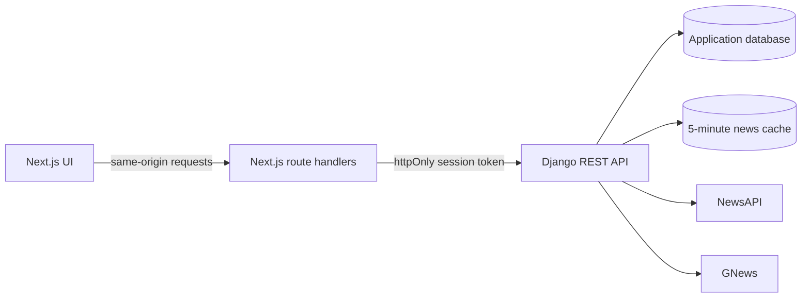

# The Global Chronicle

The Global Chronicle is a full-stack news platform built with Django 5.2, Django REST Framework 3.16, Next.js 16.4, React 19, and Tailwind CSS 4.

## Architecture



- The browser only calls same-origin `/api` routes. Django tokens are kept in an `httpOnly`, `SameSite=Lax` cookie and are never exposed to client JavaScript.
- Django merges published original reporting with cached NewsAPI and GNews headlines.
- Browsing the feed is read-only. External article metadata is persisted only when a signed-in reader comments or bookmarks it.
- Original stories follow a draft → submitted → published workflow. Editors may publish a submission or return it to draft.

## Local setup

From the repository root:

```powershell
python -m venv venv
.\venv\Scripts\python.exe -m pip install -r requirements.txt
.\venv\Scripts\python.exe manage.py migrate
.\venv\Scripts\python.exe manage.py runserver
```

In a second terminal:

```powershell
cd nexa
npm install
npm run dev
```

Copy the root `.env.example` to `.env` for Django settings. Copy `nexa/.env.example` to `nexa/.env.local` for the frontend. News provider keys belong only in the root Django environment.

## Important API routes

| Route | Purpose |
| --- | --- |
| `POST /api/auth/register/` | Create an account using Django password validation |
| `POST /api/auth/login/` | Create a Django token; the Next.js proxy stores it as an `httpOnly` cookie |
| `GET /api/feed/` | Paginated merged feed; accepts `page`, `pageSize`, `q`, `category`, `country`, and `sources` |
| `GET /api/sources/` | Available Chronicle and external providers |
| `GET/POST /api/articles/` | Paginated published articles or draft creation |
| `POST /api/articles/:id/submit/` | Submit a draft for editorial review |
| `POST /api/articles/:id/publish/` | Publish a submitted story as an editor |
| `POST /api/articles/:id/return-to-draft/` | Return a submission to its author |
| `GET/POST /api/comments/` | Read or create comments |
| `GET/POST /api/bookmarks/` | Paginated server-backed reading list |

Authentication endpoints are rate-limited. Comment and bookmark targets are protected by database constraints so each interaction belongs to exactly one original or external article.

## Verification

```powershell
# Repository root
.\venv\Scripts\python.exe manage.py test core

# nexa/
npm run lint
npm run build
```

## Configuration

Backend variables are documented in the root `.env.example`. Frontend variables:

- `DJANGO_API_URL`: server-side Django API base URL.
- `NEXT_PUBLIC_SITE_NAME`: masthead and metadata name.
- `NEXT_PUBLIC_SITE_URL`: canonical site URL used as `metadataBase`.
- `GEMINI_API_KEY`: optional server-side key for enhanced summary and translation routes.
